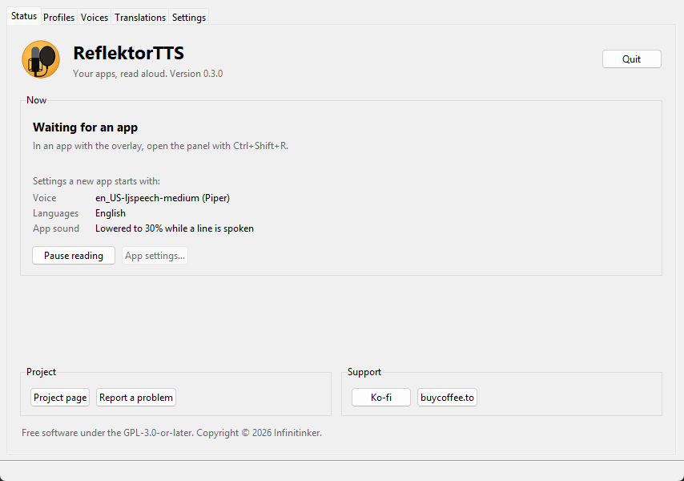
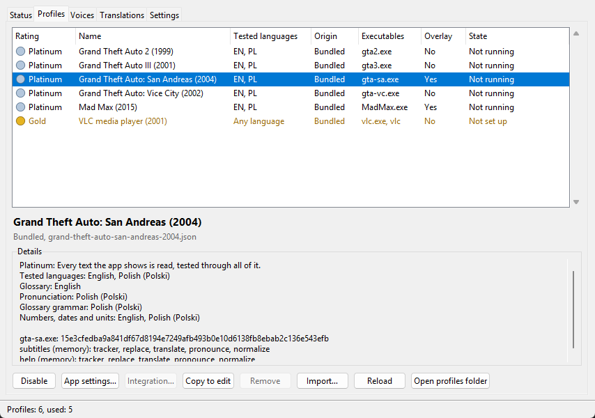
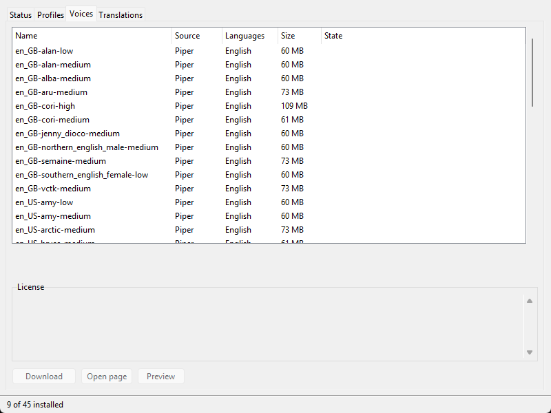
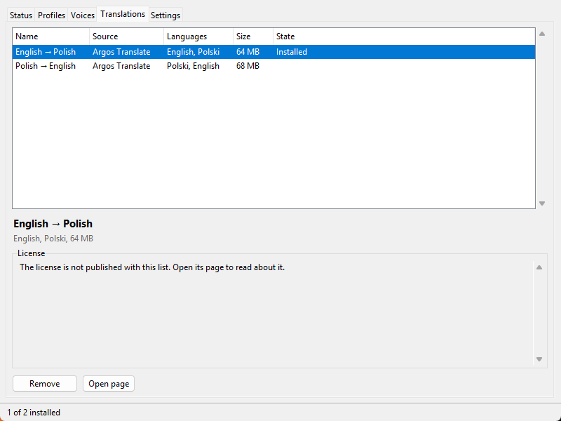

  

<h1 align="center">ReflektorTTS</h1>

  <b>Your apps, read aloud.</b> 
  Speaks the dialogue and subtitles of games and other apps, and can translate them if you like, lektor-style.

  
  
  
  
  

ReflektorTTS reads an app's text aloud as it appears on screen, and can translate it on the way, in the style of a Polish *lektor*: in Poland, foreign films are traditionally shown with one calm voice reading the translation over the original soundtrack, which stays audible underneath. ReflektorTTS does the same for games: the original sound keeps playing, a little quieter, while a voice reads the line in your language.

  <a href="https://github.com/Infinitinker/ReflektorTTS/releases/latest"><b>⬇️ Download ReflektorTTS for Windows</b></a>

## What it does

- 🗣️ **Reads the text aloud** as it appears: dialogue, cutscene subtitles, help messages.
- 🌍 **Translates it on the way**, offline, with Argos Translate models.
- 🔉 **Lowers the app's sound** while the voice speaks, and brings it back afterwards.
- 💬 **Shows subtitles** over games with the overlay, for example the translation while the original plays.
- 🎮 **Is set up from inside the game** in games with the overlay: press **Ctrl+Shift+R** for the ReflektorTTS panel, with no Alt+Tab, which older games often don't survive. Every app, with the overlay or not, can be set up from the ReflektorTTS window too.
- 🔒 **Stays on your computer**: it runs offline, the text it reads never leaves your computer, and nothing is downloaded unless you ask.
- 🧩 **Learns new apps from profiles**: one small file per app, which anyone can write and share.

## Supported apps

ReflektorTTS reads games such as Grand Theft Auto III, Vice City, San Andreas and Mad Max, and the subtitles of videos in VLC media player. [SUPPORTED-APPS.md](SUPPORTED-APPS.md) lists every app it reads, which edition, what is read in it, and a medal for how far it is tested, with the languages it was tested with. More apps can be added without changing ReflektorTTS itself; see [Profiles](#profiles).

## Getting started

1. **Download** `ReflektorTTS-<version>-windows-x64-setup.exe` from the [latest release](https://github.com/Infinitinker/ReflektorTTS/releases/latest) and run it. It installs ReflektorTTS for you alone, without asking for administrator rights, or, if you choose, for all users of the computer.
2. **Start ReflektorTTS** from the installer's last page or the Start menu. Its icon appears next to the clock; click it to open the window.
3. **Start a supported app.** ReflektorTTS notices it and reads its text aloud, with a voice Windows already has.
4. **Choose the voice**, the languages, the reading speed and more: press **Ctrl+Shift+R** in a game with the overlay ([SUPPORTED-APPS.md](SUPPORTED-APPS.md) says which), or, for any app, choose **App settings…** in the window's Status tab while the app is read.

For better voices, or to translate, download them in the window's **Voices** and **Translations** tabs.

Rather not install anything? Download `ReflektorTTS-<version>-windows-x64.zip` instead, unpack it anywhere and run `reflektortts.exe`.

<table>
  <tr>
    <td></td>
    <td></td>
  </tr>
  <tr>
    <td align="center">What ReflektorTTS is doing</td>
    <td align="center">The apps it reads, rated by how far they are tested</td>
  </tr>
  <tr>
    <td></td>
    <td></td>
  </tr>
  <tr>
    <td align="center">Voices to download</td>
    <td align="center">Translation models to download</td>
  </tr>
</table>

## The ReflektorTTS window

ReflektorTTS runs next to the clock: its icon there opens the window, pauses reading, switches **Start with Windows** on or off, or quits. Closing the window leaves ReflektorTTS running.

- **Status** shows what ReflektorTTS is doing: the app it reads, or that it waits for one, and an app version its profile does not support yet, with the voice, the languages and what happens to the app's sound: the app's own settings, or with no app running, the ones a new app starts with. When ReflektorTTS cannot read the app, it says why and what to do, until it can again. It also pauses reading, opens the settings of the app being read with **App settings…**, quits ReflektorTTS, and links to the project page, bug reports and the support pages.
- **Profiles** lists the profiles, bundled and your own, with the medal for how far each is tested and the languages it was tested with, says which are used and why others are not, enables or disables them, and copies, removes or imports profile files. **App settings…** opens the selected app's settings in a window of their own beside the ReflektorTTS window, the same as in the game, whether or not the app is running: set up an app before you start it, or one without the overlay. Clicking it again brings that window to the front. An app that can be read only once its own settings are changed, such as VLC media player, shows as **Not set up** until its integration is enabled: **Integration…** opens a window that says what the integration changes and whether it is enabled; **Enable** there makes the change, and **Disable** puts back what it changed.
- **Voices** and **Translations** download voices and translation models; see [Voices](#voices) and [Translation](#translation).
- **Settings** has the **Start with Windows** switch: ReflektorTTS then starts, hidden next to the clock, when you sign in. A first install for you alone turns it on unless you untick it; Task Manager's Startup apps can turn it off too. It also opens the settings, logs and profiles folders.

An app's voice is loaded when the app starts and unloaded when it closes. A translation model, once used, stays loaded until ReflektorTTS quits, so the next app translates right away.

## In the game

In an app with the overlay, press **Ctrl+Shift+R** to open the ReflektorTTS panel. From top to bottom it follows a line through ReflektorTTS:

- **Input**: the app's language, and which of its texts are read.
- **Processing**: the steps each line goes through, such as translation, each switched on or off for the text shown and for speech.
- **Output**: your language, the voice, the reading speed, what a new line does while another is spoken, the app's sound, pause, and subtitles.

It also shows the last line read. Everything chosen there is saved for each app, in `%LOCALAPPDATA%\ReflektorTTS\settings\profiles\`, one file per app; deleting an app's file resets it.

The same settings, without pause and the last line read, open in a window of their own from **App settings…**: in the Status tab for the app being read, in the Profiles tab for any app, running or not.

## Voices

- **Windows voices** are the ones installed in Windows Settings > Time & language > Speech, e.g. Microsoft Adam (Polish). Windows comes with some, so ReflektorTTS speaks without downloading anything.
- **Piper voices** sound more natural and are downloaded in the Voices tab. The preferred default, `en_US-ljspeech-medium`, is trained on the public-domain LJ Speech dataset.

Select a voice to read its license and open its page, then **Download** it: it can be used right away, even in an app that is running. **Preview** lets you hear an installed voice first.

Any language can be chosen as yours. Without a voice for it, lines are only translated and shown as subtitles. The Voices tab lists Piper voices in over 40 languages.

## Translation

Set the app's language in the panel's Input section and yours in Output; when they differ, each line is translated before it is spoken and shown. To hear the original instead, untick `translate` in the panel's Processing section.

Translation uses the models of [Argos Translate](https://github.com/argosopentech/argos-translate), one per pair of languages, downloaded in the Translations tab: English to and from about 50 languages, and Spanish to and from Portuguese. Two other languages can't be translated between yet, such as German to Polish. They run offline on the CPU, at about 0.1 s per line. The English–Polish model (about 80 MB), for example, is derived from an [OPUS-MT](https://github.com/Helsinki-NLP/Opus-MT) model by Jörg Tiedemann and Santhosh Thottingal and licensed CC-BY 4.0.

The in-game subtitles and panel can't show every script yet: Chinese, Japanese, Korean, Thai, Indic and some other scripts show as boxes, and right-to-left text such as Arabic, Hebrew, Persian and Urdu shows reversed. Those languages are still read aloud. A glossary's kept names come back only in translations written in Latin letters.

A profile's glossary helps the translation along: it keeps names that are also words untranslated ("Sweet" stays a name), gives slang its meaning ("hood" is not a car's hood), and says how names are pronounced ("Carl" is read "Karl" in Polish, while subtitles keep "Carl").

## The app's sound

While a line is spoken, ReflektorTTS lowers the app's sound to 30% of its own volume, like a *lektor* speaking over the original, and brings it back half a second after the voice stops. The panel's Output section switches this off or sets the level. Only the app's own slider in the Windows volume mixer changes; other apps keep theirs.

## Subtitles

In a game with the overlay, ReflektorTTS can also show each line as a subtitle over the game, for example the translation while the original plays. Switch them on under Subtitles in the panel's Output section, where you also set their size and position. They sit at the top by default, so the game's own text, usually at the bottom, stays visible.

## Profiles

Each app is described by one JSON file, a profile: how to recognize the app, where to read its text, how to process it, and its glossary. Your own go in `%LOCALAPPDATA%\ReflektorTTS\profiles\`, and the Profiles tab imports them. [docs/profiles.md](docs/profiles.md) explains the format, and [CONTRIBUTING.md](CONTRIBUTING.md) how to share a profile so it ships with ReflektorTTS.

## Questions

**My antivirus blocks `reflektortts-inject.exe`.**
The overlay works by loading into the game, as in-game overlays do, which antivirus programs may distrust. Allow `reflektortts-inject.exe` in the `overlay` folder to use the overlay; games are read without it too.

**Why isn't ReflektorTTS signed?**
ReflektorTTS is free, and the certificates Windows trusts cost money every year, so Windows warns you the first time you start it (see the next two answers). To make sure a download is the real one, compare its checksum with the list on its [release page](https://github.com/Infinitinker/ReflektorTTS/releases/latest), or check with the [GitHub CLI](https://cli.github.com/) that this repository built it: `gh attestation verify <file> --repo Infinitinker/ReflektorTTS`.

**Windows says "Windows protected your PC".**
Windows SmartScreen doesn't know ReflektorTTS yet. Choose **More info**, then **Run anyway**. It asks only once.

**Windows says Smart App Control blocked ReflektorTTS.**
Smart App Control is on for some Windows 11 PCs. It runs only apps that are signed or that Microsoft knows, and it has no **Run anyway** button, so ReflektorTTS can't run while it is on. You can turn it off in **Windows Security > App & browser control > Smart App Control settings**. Recent Windows updates let you turn it back on later; without them, turning it on again needs Windows to be reset or reinstalled, so update Windows first.

**Can I use it in online games?**
No. The overlay and reading a game's memory are meant for single-player and offline modes. Anti-cheat software may treat them as cheating, which can get your account banned.

**An app runs, but nothing is read.**
Look at the Status tab. It says when an app's version is not supported by its profile yet. The logs, opened from the Settings tab, say more.

**How do I stop ReflektorTTS from starting with Windows?**
Untick **Start with Windows** in the window's Settings tab or in its icon's menu next to the clock.

**Where are my settings?**
On Windows, in `%LOCALAPPDATA%\ReflektorTTS`, with your downloaded voices and models, your own profiles and the logs; the window's Settings tab opens the settings, logs and profiles folders. They stay when you update ReflektorTTS.

**How do I update or remove it?**
Run the newer installer. If ReflektorTTS is running, it asks you to quit it first (right-click its icon next to the clock > Quit); quit games that use the overlay too. It then updates ReflektorTTS and keeps your settings. To remove it, use Windows Settings > Apps; it asks whether to delete your settings and downloads too (removing an install for all users leaves each user's own). If you enabled the VLC integration, disable it first: deleting your settings deletes the record of what ReflektorTTS changed in VLC's settings. With the zip, replace its folder to update, and delete it and `%LOCALAPPDATA%\ReflektorTTS` to remove it.

## Contributing

Profiles for more apps, fixes and ideas are welcome: see [CONTRIBUTING.md](CONTRIBUTING.md). Found a security problem? Please report it privately, as [SECURITY.md](SECURITY.md) describes.

Further documentation:

- [SUPPORTED-APPS.md](SUPPORTED-APPS.md): the apps ReflektorTTS reads, and how far each is tested
- [docs/profiles.md](docs/profiles.md): profiles and their format
- [native/README.md](native/README.md): the native code: the overlay, and the code it shares
- [docs/architecture.md](docs/architecture.md): how ReflektorTTS is built, and what is planned
- [docs/plugins.md](docs/plugins.md): writing sources, stages, speech engines and download sources
- [docs/development.md](docs/development.md): setting up from source, running it, and the checks and tests
- [docs/releasing.md](docs/releasing.md): how a release is built and published
- [docs/api.md](docs/api.md): the local API, through which the desktop app and the overlay control ReflektorTTS

## Support

ReflektorTTS is free, with no ads and no tracking. If it makes your games better, you can buy me a coffee:

  
  

Ko-fi takes cards and PayPal; buycoffee.to suits Polish supporters, with BLIK and Polish bank transfers.

## License

Copyright (c) 2026 Infinitinker. ReflektorTTS is free software under the GNU General Public License, version 3 or any later version (GPL-3.0-or-later); see [LICENSE](LICENSE). [COPYRIGHT](COPYRIGHT) adds a permission, under section 7 of the GPL, to combine it with the Intel and NVIDIA libraries that CTranslate2, the translation engine, is built with.

ReflektorTTS ships with third-party software and data: Python, the Python packages it runs on, the native libraries of the overlay and the settings window (Dear ImGui, nlohmann/json, MinHook, SDL and the MinGW-w64 runtime), and the language data from Unicode CLDR and .NET. Their licenses and notices are in [THIRD-PARTY-NOTICES.md](THIRD-PARTY-NOTICES.md), which a release ships as `THIRD-PARTY-NOTICES.txt`.

Reading Avalanche games' files follows the formats as documented by [Gibbed.MadMax](https://github.com/gigaHours/Gibbed.MadMax) (Rick Gibbed, zlib license); file names are hashed with Bob Jenkins' public-domain lookup3. A game's text is read from your own copy while it runs and is not stored.

ReflektorTTS is not affiliated with or endorsed by the makers of the apps it reads, the games' developers and publishers and VideoLAN, the maker of VLC media player, alike; their names and trademarks belong to their owners.
